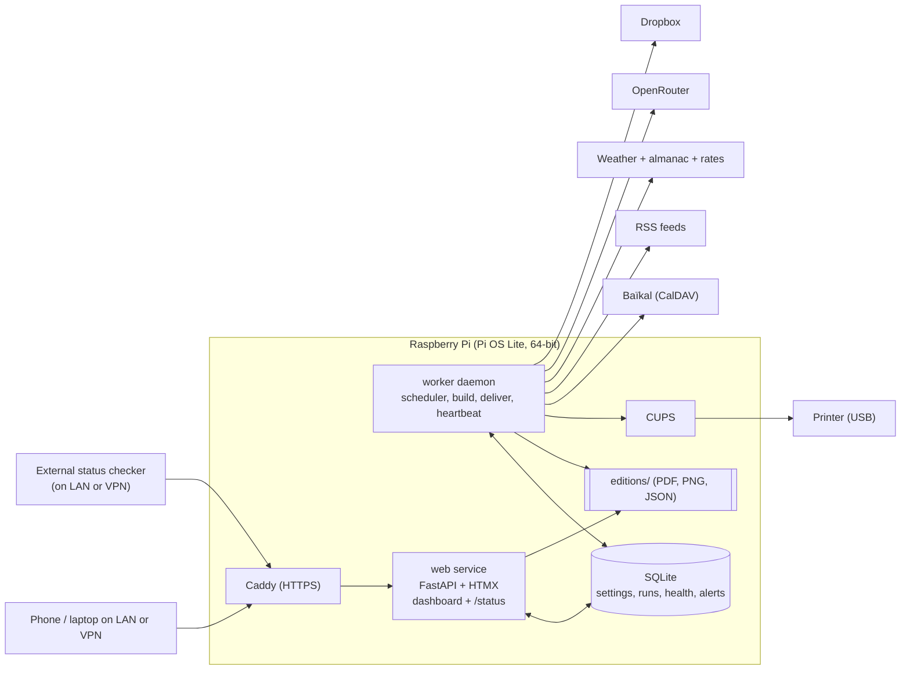

# Architecture diagrams

Two processes share one database and one editions folder. The phone or laptop, and the external checker, both reach the web service through the HTTPS proxy. Scheduled collection, printing, and upload run on the worker. Source checks also run from Test buttons and from an hourly light check. A feed that just failed is retried about once a minute. The diagram shows the scheduled path.



The worker and the web service are independent. If the dashboard process dies, a scheduled edition still prints. If the worker dies, the dashboard and `/status` show it. Process settings, the wake interval, and the library list are in stack.md.

## Edition lifecycle

```plain
scheduled -> collecting -> composing -> rendering -> [awaiting_approval] -> delivering -> done
                 \-> failed(reason)                        \-> done_degraded (fallbacks used)
```

`awaiting_approval` is present when hold mode is on. `done_degraded` means the edition finished and at least one block used a fallback. `failed` means the run stopped. The conditions for each ending are in delivery.md.
